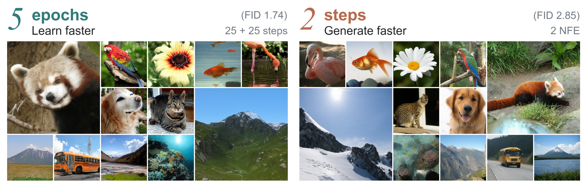
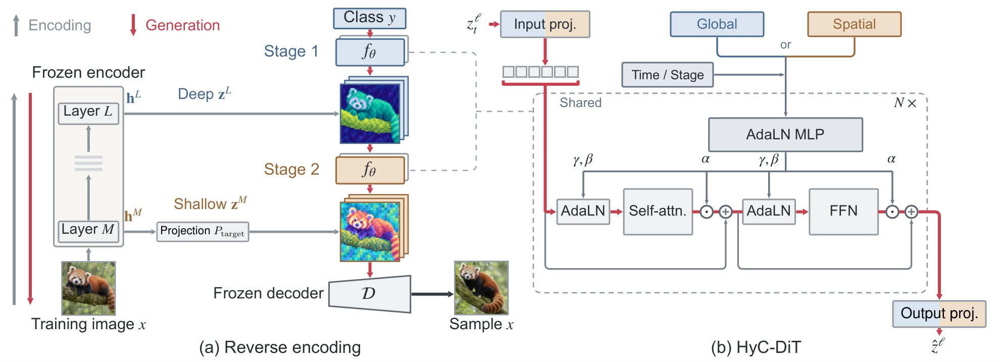
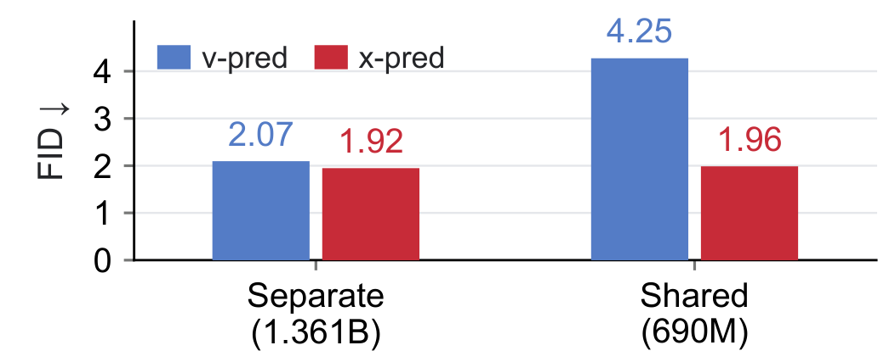

<h1 align="center">RevFlow: Generation as Reverse Encoding</h1>

<p align="center"><b>Class labels → deep semantics → shallow detail → pixels</b><br>Official PyTorch implementation · One shared DiT backbone · ImageNet 256 × 256</p>

<p align="center">Cheng Shi · Sibei Yang · Hanzhong Guo · Yipeng Qin · Pietro Lio · Yizhou Yu</p>

<p align="center">
  <a href="https://arxiv.org/abs/2611.34782"></a>
  <a href="https://www.modelscope.cn/models/chengshi0612/RevFlow"></a>
  <a href="#quick-start"></a>
  <a href="#native-matching"></a>
  <a href="LICENSE"></a>
</p>

<p align="center">
  <a href="#overview">Overview</a> ·
  <a href="#model-zoo">Model Zoo</a> ·
  <a href="#quick-start">Quick Start</a> ·
  <a href="#native-matching">Native Matching</a> ·
  <a href="#training">Training</a> ·
  <a href="#evaluation">Evaluation</a> ·
  <a href="#documentation">Docs</a> ·
  <a href="#citation">Citation</a> ·
  <a href="docs/zh.md">中文说明</a>
</p>

<p align="center">
  
</p>

*ImageNet 256 × 256 samples from RevFlow-H (5 epochs, 25 + 25 steps) and RevFlow-XL with native matching (2 NFE).*

---

RevFlow generates **class-conditional ImageNet 256 × 256 images** by reversing the hierarchy of a frozen visual encoder. A single shared LightningDiT backbone (HyC-DiT) first generates deep DINOv3 semantic features, then shallow features that preserve appearance and spatial detail. A frozen **89M ViT-B decoder** maps the shallow representation to pixels.

> **Weights on ModelScope.** Pretrained generators, the frozen codec, and flow statistics are hosted on [ModelScope](https://www.modelscope.cn/models/chengshi0612/RevFlow).

## Overview

| Fast convergence | Shared backbone | Few-step generation |
|:---|:---|:---|
| XL reaches **1.96 FID** and H **1.74 FID** in 5 epochs. | One Transformer trunk handles both deep and shallow stages. | Native matching adapts XL + DDT to **1 + 1 NFE**. |

<p align="center">
  
</p>

| Stage | Target representation | Conditioning |
|:---|:---|:---|
| **hi — semantics** | DINOv3-L block 24 features, **16 × 16 × 1024** | Class label, time, and stage; global AdaLN |
| **lo — detail** | Block 8 codec bottleneck, **16 × 16 × 128** | Spatially aligned hi features; per-token AdaLN |
| **Decode** | **256 × 256 RGB** | Frozen bottleneck decompressor and ViT-B decoder |

Both stages produce an intermediate prediction after block 8 and a final prediction after block 28. Internal guidance (REPA guidance) extrapolates between the two readouts in a single forward pass without extra network evaluations or CFG.

<details>
<summary><b>Ablation: clean-target prediction and backbone sharing</b></summary>

<p align="center"></p>

Clean-target prediction preserves generation quality with a shared backbone (1.96 vs. 1.92 FID), reducing generator parameters from 1.361B to 690M.

</details>

## Model Zoo

Checkpoints, codec, and flow statistics are available on [ModelScope](https://www.modelscope.cn/models/chengshi0612/RevFlow).

| Model | Params | Training | NFE | FID-50k ↓ | Checkpoint |
|:---|---:|:---|:---:|---:|:---|
| **RevFlow-XL** | 690M | 5 epochs | 25 + 25 | 1.96 | `stage2/revflow-xl-5ep.pt` |
| **RevFlow-H** | 1.55B | 5 epochs | 25 + 25 | 1.74 | `stage2/revflow-h-5ep.pt` |
| **RevFlow-XL** | 690M | 80 epochs | 25 + 25 | 1.36 | `stage2/revflow-xl-80ep.pt` |
| **RevFlow-H** | 1.55B | 80 epochs | 25 + 25 | **1.17** | `stage2/revflow-h-80ep.pt` |
| **RevFlow-XL + DDT (NM)** | 852M | 80ep + 1k NM | **1 + 1** | **2.90** | `native_matching/revflow-xl-nm.pt` |

Paths are relative to `pretrained_models/`. NFE counts generator evaluations and excludes the frozen pixel decoder. FID-50k is evaluated on 50,000 samples against the JiT ImageNet-256 reference statistics without CFG.

<details>
<summary><b>Download all weights or individual bundles</b></summary>

```bash
# Everything (~25 GB)
modelscope download --model chengshi0612/RevFlow --include "pretrained_models/*" --local_dir .

# Shared codec and flow statistics (required by all generators)
modelscope download --model chengshi0612/RevFlow --include "pretrained_models/stage1/*" --local_dir .

# Standard XL / H checkpoints
modelscope download --model chengshi0612/RevFlow --include "pretrained_models/stage2/*" --local_dir .

# Native-matching checkpoint, parent, chart, and statistics (also download stage1 above)
modelscope download --model chengshi0612/RevFlow --include "pretrained_models/native_matching/*" --local_dir .
```

All files are tensor-only and load with `torch.load(..., weights_only=True)`. See [manifest.json](pretrained_models/manifest.json) for file sizes and SHA-256 digests.

</details>

## Quick Start

**Requirements:** Python 3.10+, PyTorch 2.5+, and a CUDA GPU (native matching training requires PyTorch 2.7.1+ and GMuon). Sampling from released weights requires neither DINOv3 nor ImageNet.

### 1. Install

```bash
git clone https://github.com/ChengShiest/RevFlow.git
cd RevFlow

python -m pip install torch --index-url https://download.pytorch.org/whl/cu124
python -m pip install -e .
python -m pip install modelscope
```

Optional extras for native matching (`nm`), FID scoring (`fid`), and data preparation (`data`):

```bash
python -m pip install -e '.[nm,fid,data]'
```

### 2. Download XL-5ep and shared assets

```bash
modelscope download --model chengshi0612/RevFlow \
  --include "pretrained_models/stage1/*" "pretrained_models/stage2/revflow-xl-5ep.pt" \
  --local_dir .
```

### 3. Sample images

```bash
revflow-sample \
  --checkpoint pretrained_models/stage2/revflow-xl-5ep.pt \
  --codec pretrained_models/stage1/codec.pt \
  --stats pretrained_models/stage1/stats.pt \
  --classes 207 360 817 --seed 42 --output outputs/xl-5ep
```

<details>
<summary><b>Sampling commands for H-5ep, XL-80ep, and H-80ep</b></summary>

```bash
# H-5ep
revflow-sample --config revflow/configs/revflow_h_256.yaml \
  --checkpoint pretrained_models/stage2/revflow-h-5ep.pt \
  --codec pretrained_models/stage1/codec.pt --stats pretrained_models/stage1/stats.pt \
  --classes 207 360 817 --seed 42 --output outputs/h-5ep

# XL-80ep
revflow-sample --checkpoint pretrained_models/stage2/revflow-xl-80ep.pt \
  --codec pretrained_models/stage1/codec.pt --stats pretrained_models/stage1/stats.pt \
  --classes 207 360 817 --seed 42 --precision fp32 --output outputs/xl-80ep

# H-80ep
revflow-sample --config revflow/configs/revflow_h_256.yaml \
  --checkpoint pretrained_models/stage2/revflow-h-80ep.pt \
  --codec pretrained_models/stage1/codec.pt --stats pretrained_models/stage1/stats.pt \
  --classes 207 360 817 --seed 42 --precision fp32 \
  --hi-scale 2.5 --lo-scale 2.0 --hi-min-time 0.6 --output outputs/h-80ep
```

</details>

## Native Matching

Native matching adapts an 80-epoch **RevFlow-XL + DDT** generator for 1,000 updates to sample in **1 hi + 1 lo evaluation (2 NFE)** by matching distributions directly in representation space.

```bash
modelscope download --model chengshi0612/RevFlow \
  --include "pretrained_models/stage1/codec.pt" \
            "pretrained_models/native_matching/revflow-xl-nm.pt" \
            "pretrained_models/native_matching/nm-stats.pt" --local_dir .

revflow-sample --config revflow/configs/revflow_xl_nm_256.yaml \
  --checkpoint pretrained_models/native_matching/revflow-xl-nm.pt \
  --codec pretrained_models/stage1/codec.pt \
  --stats pretrained_models/native_matching/nm-stats.pt \
  --classes 207 360 817 --seed 42 --output outputs/nm
```

To run adaptation after preparing the support cache ([data preparation](data_prep/README.md#5-native-matching-support-cache)):

```bash
NNODES=2 GPUS_PER_NODE=8 NODE_RANK=0 MASTER_ADDR=node0 WEIGHTS=pretrained_models \
  bash examples/native_matching.sh
```

See [Native matching](docs/native_matching.md) for the full recipe and options.

## Training

Train the 5-epoch ImageNet 256 × 256 recipe (global batch 256, Muon + AdamW, EMA 0.9985):

```bash
NNODES=1 GPUS_PER_NODE=8 bash examples/train.sh \
  --data data/imagenet/train --dino-repo third_party/dinov3 \
  --dino-weights weights/dinov3_vitl16_pretrain_lvd1689m-8aa4cbdd.pth \
  --codec pretrained_models/stage1/codec.pt --stats pretrained_models/stage1/stats.pt \
  --output outputs/xl

# Export tensor-only EMA weights
revflow-assets export generator outputs/xl/latest.pt outputs/xl/generator.pt
```

Pass `--config revflow/configs/revflow_h_256.yaml` for RevFlow-H and `--resume outputs/xl/latest.pt` to resume. See [Training guide](docs/training.md) and [Data preparation](data_prep/README.md) for setup details.

## Evaluation

Generate 50,000 images and compute FID-50k at 2 NFE:

```bash
torchrun --standalone --nproc-per-node 4 -m revflow.native_matching.evaluate generate \
  --config revflow/configs/revflow_xl_nm_256.yaml \
  --checkpoint pretrained_models/native_matching/revflow-xl-nm.pt \
  --codec pretrained_models/stage1/codec.pt --stats pretrained_models/native_matching/nm-stats.pt \
  --count 50000 --batch-size 25 --seed 4321 --output outputs/nm-fid50k

python -m revflow.native_matching.evaluate score --output outputs/nm-fid50k \
  --reference weights/fid/jit_in256_stats.npz \
  --inception weights/fid/weights-inception-2015-12-05-6726825d.pth
```

## Documentation

| Topic | Guide |
|:---|:---|
| Five-epoch training guide | [docs/training.md](docs/training.md) |
| Native matching (2 NFE) | [docs/native_matching.md](docs/native_matching.md) |
| Data and asset preparation | [data_prep/README.md](data_prep/README.md) |
| Asset formats and flow statistics | [docs/data.md](docs/data.md) |
| 中文说明 | [docs/zh.md](docs/zh.md) |

<details>
<summary><b>Repository structure</b></summary>

```text
revflow/
├── configs/          XL, H, and native-matching YAML configs
├── models/
│   ├── revflow.py    Shared LightningDiT and hybrid conditioning
│   ├── ddt.py        DDT deep-stage prediction head
│   └── layers.py     RMSNorm, SwiGLU, RoPE, and attention
├── flow.py           Training loss and two-stage Euler sampler
├── codec.py          Frozen encoder, codec, decoder, and flow statistics
├── inference.py      revflow-sample
├── train.py          revflow-train
├── assets.py         revflow-assets (export and flow statistics)
└── native_matching/  Native-matching adaptation, support cache, and evaluation
data_prep/            ImageNet and third-party asset scripts, fixed support indices
examples/             Multi-GPU training and native-matching launchers
pretrained_models/    ModelScope download instructions and manifest
tests/                CPU unit tests (python -m unittest discover -s tests)
```

</details>

## Citation

If you find RevFlow useful in your research, please cite:

```bibtex
@article{shi2026revflow,
  title={Generation as Reverse Encoding},
  author={Shi, Cheng and Yang, Sibei and Guo, Hanzhong and Qin, Yipeng and Lio, Pietro and Yu, Yizhou},
  journal={arXiv preprint arXiv:2611.34782},
  year={2026}
}
```

## Acknowledgments

RevFlow builds on [LightningDiT](https://github.com/hustvl/LightningDiT), [DDT](https://github.com/MCG-NJU/DDT), [RAE](https://github.com/bytetriper/RAE), and [DINOv3](https://github.com/facebookresearch/dinov3). We thank [JiT](https://github.com/LTH14/JiT) and [torch-fidelity](https://github.com/toshas/torch-fidelity) for the FID protocol and evaluation tools.

## License

Released under the [MIT License](LICENSE); see [NOTICE](NOTICE) for third-party dependencies and licenses.
